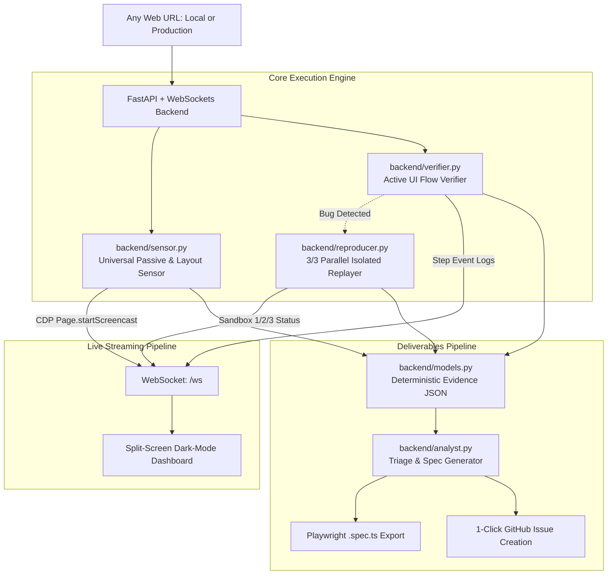

# 🦞 ClawBugger — Autonomous QA & BugHunter Engine

> **VibeNova 2026 Hackathon • Track 03: BugHunter (QA Agent)**  
> Autonomous frontend QA agent that attacks, verifies, deterministically reproduces (3/3), and generates self-healing Playwright tests for any web application.

---

## 🌟 Key Features

1. **Live 30 FPS Mobile Canvas Screencast**:
   - Streams Chrome DevTools Protocol (`Page.startScreencast`) JPEG frames over WebSockets (`ws://localhost:8000/ws`) into an iPhone-scaled interactive canvas.
2. **Universal Mobile Collision Detection (375×667)**:
   - Scans full viewport scroll ranges dynamically.
   - Evaluates `getComputedStyle(el).position === 'fixed' || 'sticky'` and tests bounding box intersections with visible interactive elements (`button, a, input, select`).
   - Strictly ignores parent-child elements and filters out micro-jitter ($<4\text{px}$).
3. **Active Chaos QA & Interaction Fuzzing**:
   - **Race Conditions**: Concurrent double-click triggers to expose async locks and double-discount stacking.
   - **State Persistence**: Cart/badge state verification across page reloads (`F5`) to catch missing `localStorage`.
   - **Form Usability Boundary**: Malformed input checks (e.g., `"a@b"`) to expose permissive email regex.
4. **Mandatory 3/3 Parallel Isolated Replay Engine (`backend/reproducer.py`)**:
   - Spawns 3 independent browser contexts concurrently (`asyncio.gather()`) to mathematically prove deterministic bug replayability.
5. **Self-Healing Playwright `.spec.ts` Regression Suite**:
   - Exports executable Playwright TypeScript tests combining semantic role locators (`page.getByRole(...)`) and fallback CSS selectors.
6. **1-Click GitHub Issue Creator**:
   - Formats complete GitHub Markdown issue payloads with environment, reproduction steps, evidence telemetry, and generated regression specs.

---

## 📐 Architecture



---

## 🚀 Quick Start

### 1. Prerequisites
- Python 3.11+
- Google Chrome or Microsoft Edge installed (or run `playwright install chromium`)

### 2. Setup & Run
```bash
# Clone the repository
git clone https://github.com/VORTEX-7rgb/Claw-Buger.git
cd Claw-Buger

# Navigate to backend and create virtual environment
cd backend
python -m venv .venv
source .venv/bin/activate  # On Windows: .venv\Scripts\activate

# Install dependencies
pip install -r pyproject.toml  # or pip install fastapi uvicorn playwright websockets httpx pydantic

# Launch ClawBugger server
python main.py
```

Open your browser to:
👉 **`http://localhost:8000`**

- Click **"Launch ClawBugger"** to run against the seeded Campus Store demo (`http://localhost:8000/store/`).
- Or enter any external URL (e.g. `https://revsmith.in`) for live web usability testing.

---

## 📁 Repository Structure

```
.
├── README.md                      # Project documentation
├── .gitignore                     # Git ignore rules
├── apps/
│   └── target-store/
│       ├── index.html             # Seeded Campus Store with 5 deterministic frontend bugs
│       └── package.json
└── backend/
    ├── models.py                  # Pydantic schemas (BugEvidence, Telemetry, WebSockets)
    ├── sensor.py                  # Universal layout math, CDP screencast, a11y & collision engine
    ├── verifier.py                # Active chaos QA verifier (race conditions, state loss, form fuzzing)
    ├── reproducer.py              # 3/3 Parallel Isolated Replayer (asyncio.gather sandbox contexts)
    ├── analyst.py                 # Self-healing Playwright .spec.ts generator & 1-Click GitHub Issue
    ├── main.py                    # FastAPI server + WebSocket hub + Monolith static file server
    ├── dashboard.html             # Split-screen dark-mode UI with live 375px mobile canvas stream
    └── pyproject.toml             # Python project dependencies
```

---

## 🛡️ Seeded Benchmark Bugs (`apps/target-store`)

| Bug ID | Title | Category | Severity | Detection Mechanism |
| :--- | :--- | :--- | :--- | :--- |
| **CLAW-001** | Rapid double-click promo code duplicate discount | Race Condition | **P0 (Critical)** | Concurrent button evaluation + discount delta check |
| **CLAW-002** | Cart items cleared on page reload (missing `localStorage`) | State Loss | **P1 (High)** | Cart addition $\to$ `page.reload()` $\to$ badge counter check |
| **CLAW-003** | Malformed email `"a@b"` accepted on checkout | Form Usability | **P2 (Medium)** | Boundary format fuzzing + order success modal assertion |
| **CLAW-004** | Fixed mobile sticky checkout bar collides with buttons | Layout Collision | **P0 (Critical)** | Universal fixed/sticky bounding box intersection math |
| **CLAW-005** | Broken asset (`404`) & missing image `alt` attribute | Accessibility | **P2 (Medium)** | Network request trapping + ARIA image audit |

---

## 📜 License
MIT License. Built for the VibeNova Hackathon 2026.
